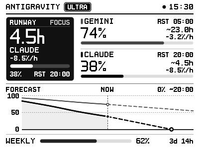
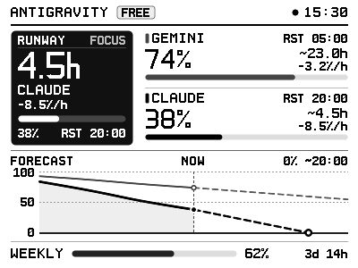

# Antigravity 额度预测看板 · ZECTRIX NOTE4

**纯 Go 实现的 Google Antigravity 额度预测看板**，为 400×300 横屏 16 级灰阶墨水屏（ZECTRIX NOTE4）渲染。单文件静态二进制、零 CGO、零第三方依赖。

把 Antigravity 订阅池的**剩余额度、消耗速率、预计耗尽时间**画成一张"油表"推送到墨水屏——抬眼三秒就知道今天还能写多久。



订阅套餐徽章三档样式（`plan_tier` 可显式指定，也可自动识别）：

| FREE | PLUS | PRO |
|---|---|---|
|  |  |  |

---

## 一、它解决什么问题

Antigravity 的额度按池分配（`GEMINI` / `CLAUDE` / `WEEKLY` 周限额），官方界面只给当前百分比，不给趋势。等发现"突然不能用了"再回头找原因，通常已经晚了。

这个看板把**趋势**搬到常亮的墨水屏上：

- 还剩多少（`RemainingPct`） · 每小时烧多少（`BurnRatePctH`）
- 按当前速率还能撑多久（`Runway`）
- 哪个池会最先见底（`Bottleneck`，左栏黑卡聚焦）

## 二、界面解读

| 区域 | 内容 |
|---|---|
| 顶栏 | `ANTIGRAVITY` 标识 + 套餐徽章（FREE/PLUS/PRO）+ 数据时刻（取快照 `UpdatedAt`，非墙上时钟） |
| 左黑卡 | 瓶颈池：`RUNWAY` 大字 + 池名 + 消耗速率 + 余量进度条 |
| 右双行 | `GEMINI` / `CLAUDE`：大号百分比、`RST` 重置时刻、`~xx h` 预计耗尽、`-x.x%/h` 消耗速率、进度条 |
| 中部 | `FORECAST` 预测图：历史实线 + `NOW` 竖虚线 + 未来虚线外推，纵轴 0/50/100 点状网格 |
| 底部 | `WEEKLY` 周限额进度条 + 周期剩余时间 |

术语：**Pool（池）**＝按上游模型分组的额度聚合；**Burn Rate**＝重置后滑动窗口加权外推的每小时消耗；**Runway**＝`剩余 / 消耗速率`；**Bottleneck**＝Runway 最短的池。

## 三、工作原理

```
CPA JSON (antigravity-*.json) —— 严格只读，程序绝不回写
        │
        ├─ 刷新后的 token 单独存 AUTH_CACHE_FILE（可选 AES-256-GCM）
        ▼
   OAuth 刷新（独立周期 + 401 触发重试 + 可选 keepalive 保活）
        │
        ▼
POST cloudcode-pa.googleapis.com/v1internal:fetchAvailableModels
        │  （主备自动切换 daily-cloudcode-pa）
        ▼
   快照落盘 STATE_FILE ──► 滑动窗口重算 Burn Rate / Runway / Forecast
        │
        ▼
  渲染 400×300 16 级灰阶 PNG（MonoGrid 点阵字库 + SDF 抗锯齿）
        │  SHA-256 像素去重 + 最小推送冷却
        ▼
POST {zectrix.base_url}/open/v1/devices/{device_id}/display/image
     multipart: pageId / dither / images[]
```

三条独立周期互不阻塞：**额度轮询**、**OAuth 刷新**、**推送节流**。配置文件支持**热更新**（默认 5 秒检查一次变更，改完保存即生效，无需重启）。采集失败时**不插值、不猜测**，仅回退展示有效期内的缓存并标记过期。

## 四、快速开始

```bash
git clone https://github.com/sakmiko/antigravity-zectrix-dashboard.git
cd antigravity-zectrix-dashboard

# 配置：TOML 优先（可热更新），也可继续用 .env / 环境变量
cp config.toml.example config.toml     # 填 CPA 路径、ZECTRIX 设备与密钥
cp .env.example .env                   # 或者走传统 env 方式

go build -trimpath -ldflags="-s -w" -o bin/antigravity-zectrix ./cmd/antigravity-zectrix
```

```bash
./bin/antigravity-zectrix --preview preview.png          # 离线渲染（无需凭证）
./bin/antigravity-zectrix --check                        # 采一次额度并打印摘要
./bin/antigravity-zectrix --trigger-refresh              # 采集 → 渲染 → 推送设备
./bin/antigravity-zectrix --refresh-auth                 # 强制刷新 token 到 auth cache
./bin/antigravity-zectrix --keepalive-once               # 跑一轮保活（OAuth 或 +loadCodeAssist）
./bin/antigravity-zectrix --env                          # 打印脱敏后的生效配置
./bin/antigravity-zectrix --preview out.png --preview-tier pro   # 指定套餐徽章渲染
```

不带参数启动即进入守护模式。

## 五、配置

**优先级：环境变量 > `.env` > `config.toml` > 内置默认。** 详细注释见 [`config.toml.example`](config.toml.example)。

| TOML 键 | 环境变量 | 默认 | 说明 |
|---|---|---|---|
| `auth.cpa_auth_path` | `CPA_AUTH_PATH` | `./fixtures/...json` | CPA 登录 JSON 或目录（目录则按 `account_email` 过滤，留空取最新修改） |
| `auth.account_email` | `CPA_ACCOUNT_EMAIL` | — | 目录模式下的账号筛选 |
| `auth.auth_cache_file` | `AUTH_CACHE_FILE` | `state` 同目录 `auth-cache.json` | 刷新后的 token 独立缓存；**源 CPA JSON 不动** |
| `auth.encryption_key_file` | `CACHE_ENCRYPTION_KEY_FILE` | — | 仅加密 auth cache，不碰源文件 |
| `auth.oauth_client_id/_secret` | `ANTIGRAVITY_OAUTH_CLIENT_ID/_SECRET` | 空 | CPA JSON 未含 client 信息时的回退；**仓库不内置凭据** |
| `network.http_proxy_url` | `HTTP_PROXY_URL` | 空 | 显式代理；留空自动采纳 `HTTPS_PROXY`/`HTTP_PROXY`/`NO_PROXY` |
| `quota.base_url` | `ANTIGRAVITY_QUOTA_BASE_URL` | `cloudcode-pa` | 额度接口主地址，失败切 `daily-cloudcode-pa` |
| `quota.user_agent` | `ANTIGRAVITY_USER_AGENT` | 空 | 自定义 UA |
| `quota.poll_interval` | `QUOTA_POLL_INTERVAL` / `QUOTA_POLL_SECONDS` | `30m` | 轮询周期，支持 `900s`/`15m`/`1h`，下限 300s |
| `quota.auth_refresh_interval` | `AUTH_REFRESH_INTERVAL` / `AUTH_REFRESH_SECONDS` | `50m` | OAuth 刷新周期，下限 300s |
| `quota.pause_windows` | `QUOTA_PAUSE_WINDOWS` | 空 | 静默窗口，如 `["01:00-07:00"]`，支持跨零点 |
| `quota.timezone` | `TIMEZONE` | `Asia/Shanghai` | 时刻显示与时区判定 |
| `quota.state_file` | `STATE_FILE` | `./state.json` | 历史快照与状态 |
| `quota.history_max_hours` | `HISTORY_MAX_HOURS` | `12` | 预测窗口 |
| `quota.stale_after` | `STALE_AFTER` / `STALE_AFTER_SECONDS` | `90m` | 超时未采集则标记过期 |
| `keepalive.enabled` | `KEEPALIVE_ENABLED` | `false` | 保活开关（可热更新开启） |
| `keepalive.interval` | `KEEPALIVE_INTERVAL` / `KEEPALIVE_INTERVAL_SECONDS` | `30m` | 保活周期，下限 60s |
| `keepalive.mode` | `KEEPALIVE_MODE` | `session` | `token` 只刷 token；`session` 额外打一次 `loadCodeAssist`（不调用推理接口） |
| `keepalive.respect_pause_windows` | `KEEPALIVE_RESPECT_PAUSE_WINDOWS` | `false` | 静默期内是否暂停保活 |
| `display.plan_tier` | `ANTIGRAVITY_PLAN_TIER` | `auto` | 套餐徽章：`auto`/`free`/`plus`/`pro`/`ultra` |
| `zectrix.base_url` | `ZECTRIX_BASE_URL` | `https://cloud.zectrix.com` | 上屏服务 |
| `zectrix.device_id` | `ZECTRIX_DEVICE_ID` | 必填 | 设备 ID，形如 `AA:BB:CC:DD:EE:FF` |
| `zectrix.api_key` | `ZECTRIX_API_KEY` | 必填 | `X-API-Key` 鉴权头 |
| `zectrix.page_id` | `ZECTRIX_PAGE_ID` | `1` | 目标页位 |
| `zectrix.dither` | `ZECTRIX_DITHER` | `false` | 硬件抖动，墨水屏一般关 |
| `zectrix.min_push_interval` | `MIN_PUSH_INTERVAL` / `MIN_PUSH_INTERVAL_SECONDS` | `60s` | 推送冷却，下限 60s |
| `hot_reload.enabled` | `HOT_RELOAD_ENABLED` | `true` | 配置热更新 |
| `hot_reload.poll_interval` | `HOT_RELOAD_INTERVAL` / `HOT_RELOAD_SECONDS` | `5s` | 变更检查周期 |

配置文件可用 `--config` / `CONFIG_FILE` 指定；`.env` 可用 `--env-file` / `ENV_FILE` 指定。

## 六、systemd 部署

```ini
[Unit]
Description=Antigravity 额度预测看板
Wants=network-online.target
After=network-online.target

[Service]
Type=simple
WorkingDirectory=/opt/antigravity-zectrix
EnvironmentFile=/var/lib/antigravity-zectrix/service.env   # 只需一行 CONFIG_FILE=...
ExecStart=/opt/antigravity-zectrix/antigravity-zectrix
Restart=always
RestartSec=10

[Install]
WantedBy=multi-user.target
```

`WorkingDirectory` 决定默认 `config.toml` / `.env` 的查找位置；`state_file` 与 `auth_cache_file` 所在目录需可写。

## 七、目录结构

```
cmd/antigravity-zectrix/   入口与 CLI、守护循环、热更新与保活
internal/antigravity/      额度客户端（主备切换、超时、UA、代理）+ 单测
internal/auth/             CPA 解析、AES-256-GCM、OAuth 刷新与 auth cache
internal/config/           TOML / .env / env 三层装载、静默窗口、脱敏摘要、热更新 + 单测
internal/predictor/        快照、滑动窗口消耗速率、Runway 与预测
internal/render/           400×300 画布、MonoGrid 点阵字库、SDF、看板编排 + 单测
internal/publisher/        ZECTRIX 推送、像素去重、限流
```

## 八、排错

| 现象 | 处理 |
|---|---|
| `dial tcp [2001:...]: network is unreachable` | 机器无 IPv6 出口。设 `http_proxy_url`，或导出标准 `HTTPS_PROXY` |
| `Could not determine client ID from request` / `client_secret is missing` | CPA JSON 里没有 client 信息且未配置回退凭据——按第五节在 `[auth]` 填 `oauth_client_id/_secret` |
| 画面长期不动 | 先 `--check`：401/403 是凭证失效；`Stale=true` 是采集失败后回退缓存（设计如此）；额度无变化时按去重策略不重复刷屏 |
| 推送 4xx | 核对 `zectrix.base_url`（实机为 `cloud.zectrix.com`）、`device_id`、`api_key` |
| 预览图与上次不同 | 顶栏时刻取自快照 `UpdatedAt`，跨分钟才变；同一分钟内两次渲染字节一致 |

## 九、变更记录

**v1.1.0**

- 新增 **TOML 配置**（`config.toml`）与**热更新**：改完保存即生效，无需重启
- CPA 源文件改为**严格只读**；刷新后的 token 落到独立 `auth_cache_file`，不再原地加密用户文件
- 新增 **keepalive 保活**（`token` / `session` 两种模式，默认关闭）
- 新增**套餐徽章**（FREE/PLUS/PRO/ULTRA，自动识别或显式指定）与三档预览图
- 新增 `user_agent` 覆盖、`--preview-tier`、`--keepalive-once`
- 补充 `internal/config`、`internal/antigravity` 单测
- 仓库**不内置 OAuth 客户端凭据**，改由配置或构建期注入

**v1.0.1** 修复首次保存路径、标准代理变量回退、`--preview` 自动建目录；module 路径归位 `github.com/sakmiko/...`。

**v1.0.0** 首个版本。

## 十、声明与许可

- 本项目读取 **CLIProxyAPI** 格式的 Antigravity OAuth 凭证并调用上游 Cloud Code Assist 内部接口（`fetchAvailableModels`）。该接口**无官方公开文档与 SLA**，字段结构、配额分组与限流策略可能随时调整；以非官方方式访问消费者 OAuth 接口存在账号风控风险，请自评估并仅在授权范围内使用。
- 看板显示的百分比与周限额仅为订阅池余量估算，**不代表 Google Cloud / Vertex AI 账单金额**，也不是精确 Token 消耗（参见 [Antigravity Pay As You Go 文档](https://antigravity.google/docs/pay-as-you-go/)）。
- 消耗速率与耗尽时间基于历史滑动窗口线性外推，**不构成额度承诺**；开启 Boost、切高消耗模型或并发多 Agent 时会显著偏离。
- 凭证仅在本地使用；刷新后的 token 可选 AES-256-GCM 加密；不向任何第三方回传凭证或日志。

MIT License，详见 [LICENSE](LICENSE)。同架构的 Codex 版本：[sakmiko/codex-zectrix-dashboard](https://github.com/sakmiko/codex-zectrix-dashboard)。
